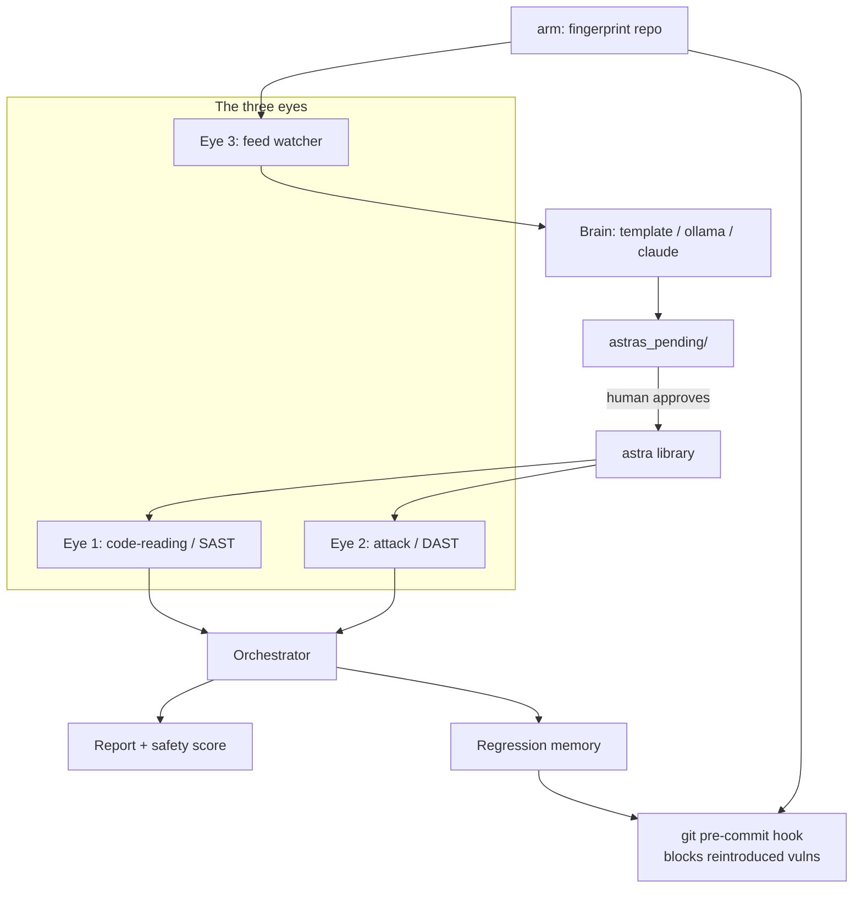

# Trinetra — a self-updating immune system for code

*A write-up of what I built, how it works, and what I learned. Written as a
first-year student, so I've tried to be honest about the limits too.*

## The problem
Most apps today are partly written by AI, and a lot of that code ships with
security holes — studies I read put it around 45%. The tools that check for
this have three gaps that bugged me:

1. They **warn** ("this might be vulnerable") instead of **proving** it.
2. They ship a **fixed list** of checks and go stale between vendor updates.
3. They **forget** — an AI coding tool happily re-introduces a bug you already
   fixed, and nothing stops it.

I wanted one tool, independent of whoever wrote the code, that proves the hole,
remembers it, and keeps itself current.

## The idea: three eyes
Trinetra (Sanskrit for "three-eyed") has three eyes:

- **Eye 1 — code-reading (SAST):** reads the source for weak spots.
- **Eye 2 — attacking (DAST):** attacks a running copy and *proves* the exploit
  with a real request/response.
- **Eye 3 — the living eye:** watches public security disclosures and grows a
  new attack-plugin (an *astra*) for each new technique, using a brain you pick.

And it **remembers**: each proven exploit becomes a regression test wired into a
git pre-commit hook, so a fixed bug can't silently come back.

## Architecture


## How each piece works
- **Astras** are tiny plugins — one file each, with `ID, NAME, SEVERITY, CWE,
  FIX` and a `run(ctx)` that returns `(proven, evidence)`. Adding an attack =
  adding a file. The engine stays dumb; the astras hold the knowledge.
- **The attack eye** sends real requests. Example: it logs in with
  `username="admin' -- "` and a wrong password; if it lands as admin, that's a
  proven SQL-injection auth bypass, with the exact request as evidence.
- **The code eye** scans source for hardcoded secrets, `debug=True`,
  string-built SQL, `eval`, and keys leaked into frontend bundles / `.env`.
- **The wall:** `arm` fingerprints the repo (Flask? Streamlit? which deps),
  stores a profile, and installs a pre-commit hook. `freeze` locks the current
  clean checks as pytest regression tests. `guard` (run by the hook) blocks any
  commit that (re)introduces a High/Critical issue.
- **The third eye:** a feed watcher reads disclosures, filters by *your* stack,
  de-dupes against known astras, and asks the brain to draft a new astra. It
  lands in `astras_pending/`, runs only against a sandbox, and **you approve it**
  before it goes live. The brain is pluggable — a free local Ollama model, or
  Claude for heavier drafting.

## Results (against ChaiCart, my deliberately-vulnerable demo app)
- **18 vulnerabilities proven** across both eyes: SQLi, IDOR, broken access
  control, mass assignment, price tampering, negative quantity, XSS, SSTI, SSRF,
  open redirect, unrestricted upload, coupon reuse, missing headers, no rate
  limit, plus code-level secrets, debug mode, string-built SQL, and a key in the
  JS bundle.
- **The wall works:** I fixed `debug=True`, froze the state, reintroduced it,
  and the commit was **blocked** — and the bad change never entered git history.
- **The third eye works:** Trinetra had no SSTI check. It read a disclosure,
  drafted an SSTI astra, I approved it, and it then caught an SSTI bug it had
  never seen before (library grew 12 → 13 astras).

### An honest test
I pointed Trinetra at a real repo of mine that turned out to be a **Streamlit
data dashboard**. It came back clean — and I kept it that way instead of
inventing findings. The reason is important: Streamlit apps don't have the
request/response endpoints the attack eye probes, so a clean result means
"clean on the checks Trinetra runs," not "fully audited." The fingerprinter now
detects this and says so. That honesty is the point.

## Honest limitations
- Trinetra makes an app **expensive to hack and always current — not
  unhackable.** No tool stops a true zero-day nobody has disclosed.
- The third eye learns **published** attacks fast; it can't invent defenses for
  secret ones.
- Astras are **surface-specific** — strongest on web apps today. Other app
  types need new astras (that's what the third eye is for).
- A local brain's drafts vary in quality, which is exactly why every drafted
  astra is sandboxed and needs human approval.

## Roadmap
- Wire real brains (Ollama first, then Claude) behind the existing registry.
- More astra families (deserialization, auth/session, framework-specific).
- A background watcher (launchd/cron) so the third eye runs on a schedule.
- Contain-and-escalate: when there's no clean fix, suggest an interim mitigation
  and a sanitized community help-request.

## Run it
```bash
python -m trinetra.cli scan --launch chaicart --html report.html
python -m trinetra.cli arm --repo /path/to/repo      # installs the wall
python -m trinetra.cli feed                          # third eye drafts astras
python -m trinetra.cli review --approve A09           # approve one
python -m trinetra.cli dashboard --launch chaicart --serve   # live UI
```

## What I learned
The hardest part wasn't the code — it was resisting the urge to overclaim. Every
time I wanted to say "stops hackers," I had to cut it down to what's actually
true. A security tool that's honest about its limits is more useful (and more
credible) than one that promises the world. Being wrong loudly is worse than
being modest and right.

*⚠️ Responsible use: only run Trinetra against targets you own or have written
permission to test. ChaiCart is an intentionally vulnerable demo; its "secrets"
are fake.*
